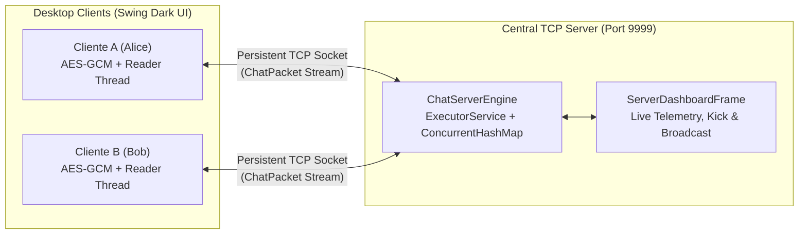

# 💬 RudimentaryChat Studio 2.0 — Encrypted Full-Duplex TCP Messenger & Server Dashboard

[](https://deepwiki.com/Drakonosinc/rudimentary_chat)


**RudimentaryChat Studio 2.0** is a modular, multi-threaded **TCP Socket Communication & File-Sharing Suite** built in pure **Java SE** (zero external dependencies). It features persistent full-duplex client connections, end-to-end **AES-GCM** authenticated encryption, public channels, 1-to-1 private direct messages (`DM`), binary file transfers, slash commands, and a real-time **Server Control Center & Packet Inspector**.

---

## 🚀 Key Capabilities

| Module | Description |
| :--- | :--- |
| **Persistent Full-Duplex TCP Engine** | Powered by `ExecutorService` and `ConcurrentHashMap`. Multiple clients can run simultaneously on the same machine (`127.0.0.1`) or across a LAN without client-side port collisions. |
| **End-to-End `AES-GCM` Encryption** | Built-in `CryptoEngine` (`AES/GCM/NoPadding` with `SHA-256` key derivation and random 96-bit IV per packet). Encrypts both text messages and binary file transfers while keeping the central server zero-knowledge. |
| **Public Channels & Private DMs** | Switch seamlessly between public channels (`#general`, `#dev`, `#gaming`, `#offtopic`) and 1-to-1 private conversations by clicking any online user in the sidebar or using `/w <user> <msg>`. |
| **Encrypted File & Image Sharing** | Send any file across the TCP socket (`FILE_TRANSFER`), automatically encrypted with AES-GCM and prompted for download on the recipient's desktop. |
| **Server Dashboard & Packet Inspector** | Live telemetry cards (`Usuarios Online`, `Mensajes Enrutados`, `Archivos Transferidos`, `Paquetes AES-GCM`), active client table, 1-click **Kick User** moderation, and **Global Broadcast Announcements**. |
| **Slash Commands & Transcript Export** | Supports `/help`, `/w <user> <msg>`, `/roll` (1–100 dice roller), `/clear`, live presence status (`Online`, `Ausente`, `Ocupado`), and 1-click chat history export (`.txt`). |

---

## 🏗️ System Architecture



```text
rudimentary_chat/
├── Servidor.java                              # Server entry point (launches ServerDashboardFrame)
├── Cliente.java                               # Client entry point (launches ClientMessengerFrame)
├── src/
│   └── chat/
│       ├── protocol/
│       │   ├── PacketType.java                # Wire frame types (CONNECT, CHAT_MESSAGE, PRIVATE_MESSAGE, FILE_TRANSFER...)
│       │   ├── UserStatus.java                # Presence states (ONLINE, AWAY, BUSY)
│       │   ├── UserInfo.java                  # Immutable participant descriptor
│       │   └── ChatPacket.java                # Serializable protocol envelope
│       ├── security/
│       │   └── CryptoEngine.java              # Authenticated AES-GCM encryption & SHA-256 key derivation
│       ├── server/
│       │   ├── ChatServerEngine.java          # Multi-threaded TCP relay engine & moderation controller
│       │   └── ServerDashboardFrame.java      # Dark Swing Server Control Center & Packet Inspector
│       ├── client/
│       │   ├── ChatClientConnection.java      # Persistent full-duplex client socket & AES-GCM adapter
│       │   └── ClientMessengerFrame.java      # Dark Swing Messenger UI (Channels, DMs, Files, Slash Commands)
│       └── ui/
│           └── DarkTheme.java                 # Shared Dark Studio color palette & component factory
└── tests/
    └── ChatIntegrationTest.java               # Automated headless integration test suite (5/5 tests)
```

---

## ⚡ Quick Start

### 1. Compile Sources

```bash
mkdir bin
javac -encoding UTF-8 -d bin -sourcepath ".;src;tests" Servidor.java Cliente.java tests/ChatIntegrationTest.java
```

### 2. Start the Central Server Dashboard

```bash
java -cp bin Servidor
```

### 3. Launch Multiple Clients (on the same PC or across LAN)

Open two or more terminals and run:

```bash
java -cp bin Cliente 127.0.0.1 9999 Alice
java -cp bin Cliente 127.0.0.1 9999 Bob
```

### 4. Run the Automated Integration Test Suite

```bash
java -cp bin ChatIntegrationTest
```
