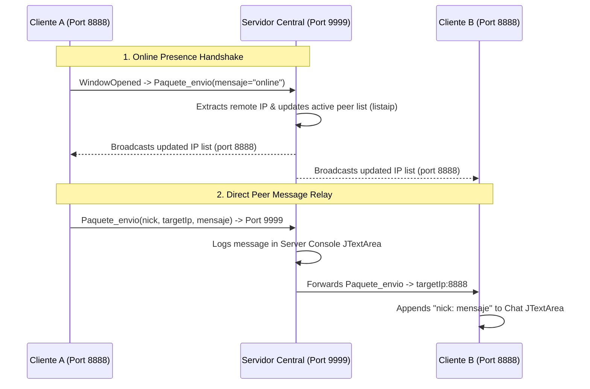

# 💬 Rudimentary Chat — Java TCP Sockets & Multi-Threaded Swing Messenger

[](https://deepwiki.com/Drakonosinc/rudimentary_chat)


A multi-threaded **Client-Server LAN Chat Application** written in **Java SE** using **TCP Sockets (`java.net.Socket` / `ServerSocket`)**, **Java Object Serialization (`ObjectInputStream` / `ObjectOutputStream`)**, and a **Java Swing** desktop GUI.

It features automatic online peer discovery (`EnvioOnline` window listener), dynamic IP routing via a central relay server, and asynchronous background listener threads (`Runnable`).

---

## 🏗️ System Architecture & Communication Flow



---

## 📦 Core Components

| Class | File | Responsibility |
| :--- | :--- | :--- |
| `Servidor` / `Marco_servidor` | `Servidor.java` | Launches the central relay GUI window and starts the background listener thread. |
| `Lamina_servidor` | `Servidor.java` | Implements `Runnable`; listens on **TCP port `9999`**, tracks connected client IPs, broadcasts online peer lists, and routes chat packets to target clients on port `8888`. |
| `Cliente` / `Marco_cliente` | `Cliente.java` | Initializes the client chat window and registers the `EnvioOnline` window lifecycle hook. |
| `EnvioOnline` | `Cliente.java` | Extends `WindowAdapter`; automatically transmits an `"online"` registration packet to the server as soon as the client window opens. |
| `Lamina_cliente` | `Cliente.java` | Prompts for the user's nickname, renders the active peer `JComboBox`, sends serialized messages on button click, and runs a `ServerSocket(8888)` thread to receive incoming messages. |
| `Paquete_envio` | `Cliente.java` | `Serializable` Data Transfer Object (DTO) encapsulating `nick`, target `ip`, `mensaje`, and the `ArrayList<String> ips` roster. |

---

## 🚀 Compilation & Execution

### 1. Configure Network IP (Optional for Localhost Testing)
In `Cliente.java` (lines 41 and 108), set the server IP address to `127.0.0.1` for local testing or to your LAN server's IPv4 address (default `192.168.1.2`).

### 2. Compile Sources
```bash
javac Cliente.java Servidor.java
```

### 3. Start the Central Server First
```bash
java Servidor
```

### 4. Launch One or More Clients
```bash
java Cliente
```
Enter your nickname when prompted, select an online peer IP from the dropdown menu, type a message, and click **Enviar**.
